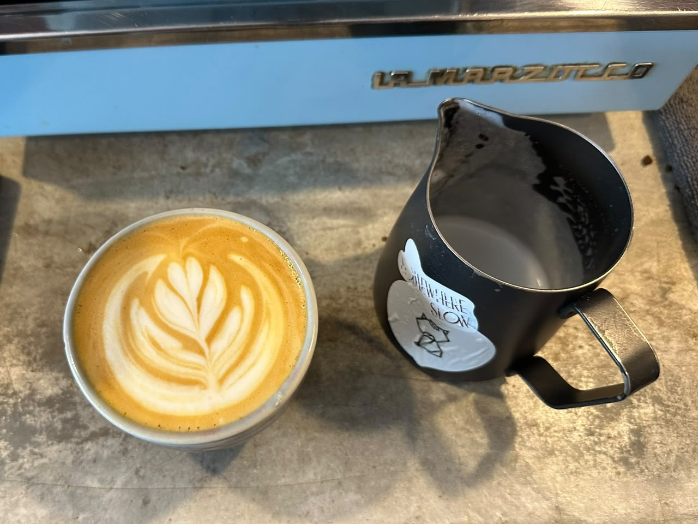

# Introduction
Hi! I'm Aqmal Iman, a student in the Software Maintenance and Evolution course.
I expect to learn a lot about modern software maintenance practices and how to work with legacy systems.

- **Fun fact**: I love discovering new songs while reading my book in my free time.
- **Course expectations**: I hope to learn how to maintain and improve existing software systems, identify and resolve defects, refactor code, and adapt applications to changing requirements. I also want to understand how software maintenance practices contribute to the long-term quality and reliability of software.

